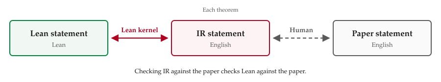
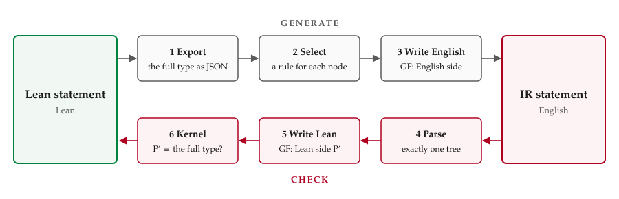

# IRStatement: checked English readings of Lean theorems

IRStatement reads the full Lean type of each theorem in this repository (35 papers on language generation in the limit, P00–P39) as short controlled English: the IR (Intermediate Representation) statement. The Lean kernel checks every IR statement against the Lean theorem.



[Web pages](Web/index.html) · [Readings](Readings/README.md) · [Results](RULES.md#current-results) · [Rules](RULES.md) · [File structure](STRUCTURE.md) · [Rule cards](RULE-CARDS.md)

## How it works



Example: [one theorem, P39 Theorem 3.15, through every step](STRUCTURE.md#follow-one-reading-through-the-files).

- The grammar is written in [GF](https://www.grammaticalframework.org/), the Grammatical Framework ([Ranta 2011](#references)). Each rule has an English side and a Lean side with the same slots. So one tree is both one English text and one Lean proposition.
- Steps 1–3 may fail or read awkwardly, but cannot publish a wrong reading: steps 4–6 start from the saved text, which must have exactly one parse, and the kernel compares its Lean proposition with the theorem's entire type.
- Random trees test the grammar for ambiguity: each must parse back to itself only. This is a sample, not a proof.
- Each italic label is the name of a Lean constant. Its definition is read and checked the same way, and the web page shows it at the end (`glossary.py`).
- The paper's statements are quoted word for word, checked against the PDF and the LaTeX source (`quotes.py`).

## What is checked by Lean, and what a person still checks

- **Trusted base:** the tokenizer, GF, `#check_statement` ([Check.lean](Check.lean), 38 lines) and the Lean kernel.
- **Reviewed once:** the rule cards, the sentence frames, `Vocabulary.lean`, the label algorithm, `#ir_glossary` and the Throughout substitution. After that, every reading says what its Lean declaration says. [RULES.md](RULES.md), "How to review", lists the steps.

## Run it

You need:

- Lean 4.24 (through `elan`) and this repository's Lake project.
- The GF binary: `GF_BIN`, `gf` on the path, or a copy in `local/tools/` here.
- Python 3 with `pypdf`, and `pandoc` for the web pages.

From the repository root:

```sh
D=GenLimitLean/IRStatement
python3 $D/Scripts/reader.py                # P01 with its negative controls, under a minute; writes no log
python3 $D/Scripts/reader.py --write --all  # every paper, P00–P39, about 10 min
python3 $D/Scripts/glossary.py --write      # the definitions of the labels
python3 $D/Scripts/web.py --fetch           # the web pages, about 3 min; --fetch downloads missing papers
```

## References

- Aarne Ranta. *Grammatical Framework: Programming with Multilingual Grammars.* CSLI Publications, Stanford, 2011. The recommended reference for GF.
- Aarne Ranta. Symbolic informalization: fluent, productive, multilingual. [arXiv:2606.16893](https://arxiv.org/abs/2606.16893), 2026. The Informath project: rule-based informalization of Agda, Lean and Rocq through Dedukti and GF. Our IRStatement also uses GF but is a separate design: it reads Lean's types directly, without Dedukti, and writes only English that parses back uniquely, so that the Lean kernel can check every output.
